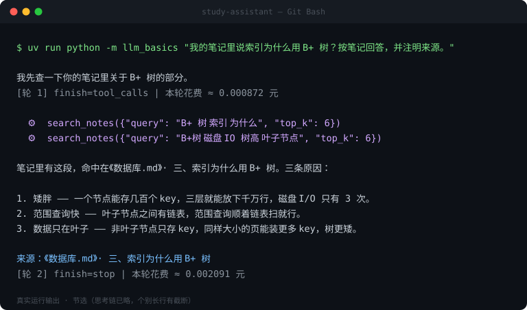

# study-assistant

> 一个**不依赖 Agent 框架**、从零手写的命令行学习助手。
> 手写 ReAct 循环 · 工具调用 · 关键词 RAG · **自带 MCP 客户端与服务器**



*上图是真实运行输出（节选）。想看动图的话可以自己录一个，方法见 [docs/录屏说明.md](docs/录屏说明.md)。*

---

## 这是什么

一个跑在终端里的 AI 学习助手，人设是「计算机学习导师」——
它会反问你思路、查你的笔记、给答案标注出处、每一轮都告诉你花了多少钱。

它的特别之处不在于功能多，而在于**每一层都是自己写的**：

| 能力 | 实现方式 |
|---|---|
| Agent 循环 | 手写 ReAct：流式累积工具分片 → 执行 → 回填 → 继续推理 |
| 工具系统 | 统一注册表，schema + 函数配对，**分发永不抛异常** |
| MCP | **手写 JSON-RPC over stdio 客户端**，同时自带一个 MCP 服务器 |
| 检索增强 | 切分 + jieba 分词 + BM25 打分 + 引用，缺陷有量化 |
| 上下文管理 | 自己实现截断，保住 system、丢掉孤儿 tool 消息 |
| 成本核算 | 缓存命中/未命中分开计价，精确到 0.000001 元 |

**这不是什么**：不是 RAG 教程、不是 LangChain 封装、不是聊天玩具。
它的价值在于**可解释** —— 你能看到模型每一步在想什么、调了什么工具、花了多少钱，
也能看到每个设计选择的代价。

---

## 三个不常见的地方

### 1. Agent 循环是手写的，没有 `create_agent`

`agent.py` 里那个 `for turn in range(max_turns)` 就是全部。流式分片怎么攒、
assistant 消息怎么回填、孤儿 tool 消息怎么处理 —— 每一行都能讲。

### 2. MCP 客户端也是手写的，没装 SDK

MCP 的 stdio 传输协议本体只有四个方法：`initialize` / `notifications/initialized` /
`tools/list` / `tools/call`，一行一条 JSON，走 stdin/stdout。

`mcp_client.py` 对着协议实现了它，`mcp_server.py` 实现了另一端。
**两端加起来不到 500 行，但能把「工具」从进程内的函数变成可跨进程分发的服务。**

> 为什么不用官方 `mcp` SDK：它的客户端是 async 的，而本项目的循环是同步的，
> 中间要架一层事件循环线程。协议本体很小，手写反而更清楚、更好调试。
> 要接公司现成的 MCP 生态，把 `MCPClient` 换成官方 SDK 即可，接口是一样的。

### 3. 检索基线的缺陷有量化，不是「效果不错」

长度偏置和语义盲区都能一条命令复现，数字见[实测数据](#实测数据)。

---

## 架构

```
                      ┌───────────┐
   你 > 问题 ──────────►│  cli.py   │  chat / ask / search / tools / doctor
                      └─────┬─────┘
                            ▼
                      ┌───────────┐
                      │ agent.py  │ ◄─── 工具结果回填，回到循环开头
                      └─────┬─────┘
                            │ 1. 流式请求（截断历史 → 拼工具 schema）
                            ▼
                      ┌───────────┐
                      │ DeepSeek  │  deepseek-flash · 流式 · usage 实时计价
                      └─────┬─────┘
                            │ 2. finish_reason == tool_calls ?
                            ▼
                      ┌───────────┐
                      │ registry  │  统一分发（永不抛异常）
                      └─────┬─────┘
                            │ 3. 执行 + 把结果包成 tool 消息
          ┌─────────────────┼─────────────────┐
          ▼                 ▼                 ▼
    ┌───────────┐     ┌───────────┐     ┌───────────┐
    │  builtin  │     │   notes   │     │    MCP    │
    └───────────┘     └───────────┘     └─────┬─────┘
    get_time          read_notes              │ JSON-RPC
    calculate         list_notes              ▼
                      search_notes      ┌───────────┐   ← 独立进程
                                        │ MCP server│
                                        └───────────┘
```

**关键点**：模型只负责「决定调哪个工具、传什么参数」，**执行永远在我的代码里**。
它在云端，没有我的时钟、没有我的文件 —— 这是 Tool Calling 的第一性原理。

---

## 快速开始

**前置**：Python 3.13+、[uv](https://docs.astral.sh/uv/)

```bash
git clone https://github.com/chillydusk/study-assistant.git
cd study-assistant

cp .env.example .env          # 然后编辑 .env，填入 DeepSeek key（platform.deepseek.com）
uv sync

uv run study-assistant doctor        # 环境自检
uv run study-assistant ask "三次握手的序列号是怎么定的？"
```

> 💡 **国内网络**：`uv sync` 如果卡住，是 `files.pythonhosted.org` 被限速。
> 用镜像：`UV_DEFAULT_INDEX=https://mirrors.aliyun.com/pypi/simple uv sync`
> （只在当前命令生效，不会改你的全局配置）

> 🧰 **VS Code 满屏红线？** 先看 [docs/VS Code 常见问题.md](docs/VS%20Code%20常见问题.md)。
> 判断标准只有一条：**命令行能跑 = 代码没问题，是 IDE 选错了解释器。**

### 命令行

| 命令 | 作用 |
|---|---|
| `study-assistant chat` | 交互模式（默认）；`/clear` `/tools` `/cost` `/exit` |
| `study-assistant ask "问题"` | 单问一次 |
| `study-assistant search "查询"` | **只测检索，不花 token** |
| `study-assistant tools` | 列出当前注册的所有工具（含 MCP） |
| `study-assistant mcp list` | 看 MCP 服务器状态与工具清单 |
| `study-assistant mcp serve` | 把自己当 MCP 服务器启动 |
| `study-assistant doctor [--online]` | 环境自检（`--online` 会做一次真实调用） |

退出码：`0` 正常 / `1` 模型错误 / `2` 配置错误 / `130` Ctrl+C。

---

## MCP：把工具变成进程

### 它解决什么问题

没有 MCP 时，给 Agent 加一个能力 = 往 `tools.py` 里加一个函数，然后重新部署。
有 MCP 后，那个能力可以是**别人仓库里的一个进程**，你只写四行配置。

本项目的做法更彻底一点：**笔记工具默认就跑在 MCP 服务器进程里**。
主程序不再 import `read_notes`，而是启动子进程、握手、`tools/list`、
把拿到的 16 个 schema 当成普通工具挂进注册表。

### 怎么配

`mcp_servers.json`（字段沿用 Claude Desktop 的约定）：

```json
{
  "mcpServers": {
    "notes": {
      "command": "{python}",
      "args": ["-m", "study_assistant.mcp_server"],
      "enabled": true
    }
  }
}
```

`{python}` 会展开成当前解释器。加一个第三方服务器，就是再加一段：

```json
{
  "command": "npx",
  "args": ["-y", "@modelcontextprotocol/server-filesystem", "/path/to/dir"]
}
```

起不来的服务器**不会阻断启动** —— 会降级、记日志、在 `study-assistant mcp list` 里标红。

### 怎么验证

```bash
uv run study-assistant tools        # notes 工具的 source 应该显示 mcp:notes
uv run study-assistant mcp list     # 服务器版本 + 工具清单
uv run pytest tests/test_mcp.py -v  # 协议两端都有测试
```

---

## 工程化

| 关注点 | 做法 | 代码 |
|---|---|---|
| **配置** | 单一 `Settings`，启动即校验；**路径全部锚定项目根**，在哪个目录跑都一样 | `config.py` |
| **日志** | 控制台只放 WARNING+，文件记 DEBUG+ 并轮转（2 MB × 3） | `logging_setup.py` |
| **异常** | `StudyAssistantError` 分四类；上层只认自家异常，不认 SDK | `errors.py` |
| **重试** | 只在「还没吐任何内容」时重试，避免用户看到两份答案 | `llm.py` |
| **安全** | 笔记路径 `resolve()` 后做包含检查，`../../.env` 读不到 | `tools.py` |
| **可观测** | 每轮打印 finish_reason / 命中 / 输入 / 输出 / 花费；会话结束给总额 | `agent.py` |
| **测试** | 67 个用例，假 LLM 跑通整条循环，MCP 两端都覆盖 | `tests/` |
| **CI** | GitHub Actions：ruff + ruff format + pytest（Ubuntu & Windows） | `.github/workflows/ci.yml` |

---

## 项目结构

```
study-assistant/
├── src/study_assistant/
│   ├── cli.py           命令行入口（argparse 子命令）
│   ├── config.py        配置 + 校验 + 路径锚定
│   ├── agent.py         ⭐ 手写 ReAct 循环
│   ├── tools.py         工具注册表 + 内置工具 + 笔记工具
│   ├── rag.py           切分 / jieba / BM25 / 引用
│   ├── mcp_client.py    ⭐ 手写 MCP 客户端（JSON-RPC over stdio）
│   ├── mcp_server.py    ⭐ 自带 MCP 服务器（暴露 notes/）
│   ├── llm.py           模型客户端（流式 / 重试）
│   ├── usage.py         token 计费
│   ├── history.py       会话截断
│   ├── logging_setup.py 日志
│   ├── errors.py        异常层级
│   └── langchain_agent.py  LangChain 对照实现
├── tests/               67 个用例
├── notes/               笔记语料（检索对象）
├── docs/
│   ├── 手写-vs-LangChain.md   两套实现的对比表（含实测数据）
│   ├── demo.svg              终端实录
│   └── 录屏说明.md            换成 GIF 的步骤
├── mcp_servers.json     MCP 配置
└── _demo_rag.py         检索两个缺陷的实测脚本
```

---

## 实测数据

| 项 | 数值 |
|---|---|
| 依赖包 | 纯手写 18 个 → 引入 LangChain 后 48 个（+30） |
| Agent 循环代码 | 手写 74 行 → LangChain 18 行 + 适配层 31 行（净省 1/3，不是 4 倍） |
| 检索语料 | 16 段 / 4 份笔记 / 427 个词项 |
| **长度偏置** | 原式 长段 **9.89** > 短段 6.59（错）→ BM25 短段 **5.57** > 长段 3.42（对） |
| **语义盲区** | 查「建立连接」→ 讲「**无连接**」的 UDP 段 **5.42 分排第一**，调参救不了 |
| MCP 通信 | 3 个工具跨进程调用，单次往返 < 5 ms |
| 一次两轮问答 | ≈ 0.004 元（deepseek-flash，含两次检索） |
| 测试 | 67 passed，覆盖率 55% |

复现两个缺陷：

```bash
uv run python _demo_rag.py
```

完整的手写/框架对比见 [docs/手写-vs-LangChain.md](docs/手写-vs-LangChain.md)。

---

## 已知限制

写在这里，是因为**知道自己系统的边界比功能列表更能说明水平**。

1. **关键词检索不懂语义**。「无连接」会命中「连接」，否定、同义词、缩写全抓不到。
   量化见上表。下一步：接 embedding（DeepSeek 不提供，需换供应商或本地模型）。
2. **MCP 只实现了 stdio 传输**。HTTP/SSE 传输、resources、prompts、sampling 都没做，
   只覆盖了 tools 这一类能力。
3. **没有持久化**。关掉终端对话就没了，没有 checkpointer / 数据库。
4. **单用户单会话**。没有并发、没有鉴权 —— 它本来就是个本地 CLI 工具。
5. **检索索引每次启动重建**（毫秒级）。语料上千段时需要落盘 + 增量更新。

---

## 路线图

- [x] 手写 ReAct 循环（流式 + 工具回填 + 多轮）
- [x] 成本核算与人设加载
- [x] 关键词检索基线 + 引用
- [x] LangChain 对照实现与量化对比
- [x] **MCP 客户端 + 服务器（stdio）**
- [x] **工程化：配置 / 日志 / 异常 / 安全 / 测试 / CI**
- [ ] 向量检索（找一家有 embedding 的供应商，量出相对基线的提升）
- [ ] 会话持久化
- [ ] MCP HTTP 传输与 resources 支持

---

## 参考

- 工程结构与 MCP 集成的思路参考了 [Hello-Agents 第十三章 · 智能旅行助手](https://hello-agents.datawhale.cc/#/./chapter13/第十三章%20智能旅行助手)
  （多智能体协作 + MCP 工具集成）。本项目**没有**照搬它的 Web 前后端与四 Agent 编排 ——
  一个本地 CLI 不需要 Vue，也不需要为一个工具链拆出四个 Agent。取的是它的工程分层与 MCP 用法。

## License

MIT
